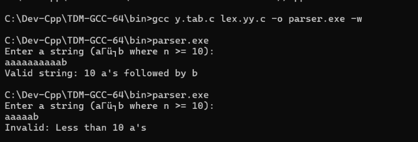

# COMPILER_DESIGN_EX5
# Flex and Yacc Program – Recognition of aⁿb (n ≥ 10)

## 1. Aim

To develop a Lex and Yacc program to recognize strings that contain 10 or more occurrences of the character `a`, followed by exactly one occurrence of the character `b`.

The program accepts strings in the form:

```text
aaaaaaaaaab
aaaaaaaaaaab
aaaaaaaaaaaab
```

The minimum number of `a` characters must be 10, and the string must end with exactly one `b`.

## 2. Objective

- To understand lexical analysis using Flex.
- To understand syntax analysis using Yacc.
- To identify and count the occurrences of a particular character.
- To validate strings based on a given grammar.
- To understand how Flex and Yacc work together to recognize valid strings.

## 3. Software Requirements

- **Operating System:** Windows 10 / Windows 11
- **Compiler:** GCC (TDM-GCC)
- **Lexical Analyzer:** Flex
- **Parser Generator:** Yacc / Bison
- **Programming Language:** C

## 4. Lex Program

**Filename:** `ex5_212225230129.l`

```c
%{
#include "y.tab.h"
%}

%%
a   { return A; }
b   { return B; }
\n  { return '\n'; }
.   { return yytext[0]; }
%%

int yywrap() {
    return 1;
}
```

### Explanation of Lex Program

1. `%{ %}`: This section contains C header files and declarations that are copied into the generated Lex program.

2. `#include "y.tab.h"`: Includes the header file generated by Bison. It contains the token definitions used by the parser.

3. `a { return A; }`: Whenever Flex identifies the character `a`, it returns the token `A` to Yacc.

4. `b { return B; }`: Whenever Flex identifies the character `b`, it returns the token `B` to Yacc.

5. `\n { return '\n'; }`: Recognizes the newline character and returns it to Yacc.

6. `. { return yytext[0]; }`: Recognizes any other character and returns it to Yacc. This helps the parser identify invalid input.

7. `yywrap()`: Indicates that the lexical analyzer has reached the end of the input.

## 5. Yacc Program

**Filename:** `ex5-212225230129.y`

```c
%{
#include <stdio.h>
#include <stdlib.h>
int count = 0;
%}

%token A B

%%
start:
    sequence B '\n' {
        if (count >= 10) {
            printf("Valid string: %d a's followed by b\n", count);
        } else {
            printf("Invalid: Less than 10 a's\n");
        }
        count = 0;
    }
    ;

sequence:
    A { count++; }
  | sequence A { count++; }
  ;
%%

int main() {
    printf("Enter a string (aⁿb where n >= 10):\n");
    return yyparse();
}

void yyerror(const char *msg) {
    printf("Syntax error: %s\n", msg);
}
```

### Explanation of Yacc Program

**1. Header Section**

The `stdio.h` header file is used for input and output operations. The `stdlib.h` header file provides standard library functions.

The variable `count` is initialized to zero. It is used to count the number of `a` characters in the input string.

**2. Token Declaration**

```c
%token A B
```

This declares two tokens, `A` and `B`, which are received from the Lex program.

**3. Grammar Rules**

The grammar defines the valid structure of the input string.

```text
start → sequence B newline
sequence → A
sequence → sequence A
```

- `start`: The starting grammar rule.
- `sequence`: Represents one or more occurrences of `a`.
- `B`: Represents exactly one occurrence of `b`.
- `newline`: Indicates the end of the input line.

**4. Counting the Characters**

```c
A { count++; }
```

Whenever an `A` token is recognized, the count is increased by one.

```c
sequence A { count++; }
```

This allows additional `a` characters to be accepted and counted.

**5. Validation Condition**

```c
if (count >= 10)
```

This condition checks whether the input contains at least 10 `a` characters.

- If the count is 10 or greater, the string is valid.
- If the count is less than 10, the string is invalid.

**6. Main Function**

The `main()` function displays the input message and calls `yyparse()` to begin the parsing process.

**7. Error Handling**

The `yyerror()` function displays a syntax error message whenever the input does not follow the defined grammar.

## 6. Working Principle

The program works through two main stages:

**Stage 1: Lexical Analysis**

Flex reads the input character by character. It identifies `a` and `b` and converts them into tokens `A` and `B`.

**Stage 2: Syntax Analysis**

Yacc receives the tokens generated by Flex. It checks whether the input follows the grammar rules and counts the number of `a` characters.

Finally, it checks whether the count is at least 10 and displays the appropriate result.

# OUTPUT:

## 7. Compilation and Execution

Execute the following commands in the TDM-GCC bin directory.

**Step 1: Generate the Lex analyzer**

```bash
flex ex5_212225230129.l
```

**Step 2: Generate the Yacc parser**

```bash
bison -dy ex5-212225230129.y
```

**Step 3: Compile both generated files**

```bash
gcc y.tab.c lex.yy.c -o parser.exe -w
```

**Step 4: Execute the program**

```bash
parser.exe
```

## 8. Sample Input and Output

### Example 1: Valid Input (10 a's)

**Input:**

```text
aaaaaaaaaab
```

**Output:**

```text
Enter a string (aⁿb where n >= 10):
Valid string: 10 a's followed by b
```

### Example 2: Valid Input (12 a's)

**Input:**

```text
aaaaaaaaaaaab
```

**Output:**

```text
Enter a string (aⁿb where n >= 10):
Valid string: 12 a's followed by b
```

### Example 3: Invalid Input (5 a's)

**Input:**

```text
aaaaab
```

**Output:**

```text
Enter a string (aⁿb where n >= 10):
Invalid: Less than 10 a's
```

### Example 4: Invalid Input (Incorrect Order)

**Input:**

```text
baaaaaaaaaa
```

**Output:**

```text
Enter a string (aⁿb where n >= 10):
Syntax error
```

### Example 5: Invalid Input (Multiple b's)

**Input:**

```text
aaaaaaaaaabb
```

**Output:**

```text
Enter a string (aⁿb where n >= 10):
Syntax error
```

## 9. Applications

- Understanding lexical analysis and syntax analysis.
- Recognizing strings based on formal grammar rules.
- Counting occurrences of specific characters.
- Implementing simple language recognition systems.
- Learning the working relationship between Lex and Yacc.

## 10. Result

The Lex and Yacc program was developed to recognize strings of the form `aⁿb`, where `n ≥ 10`. Flex identifies the input characters and generates tokens, while Yacc checks the grammar and counts the occurrences of `a`. The program successfully distinguishes between valid and invalid strings based on the specified conditions.

## 11. Conclusion

This program demonstrates how Flex and Yacc work together to perform lexical and syntax analysis. Flex converts input characters into tokens, and Yacc validates the sequence using grammar rules. The program also demonstrates how semantic actions can be used to count characters and apply additional validation conditions.